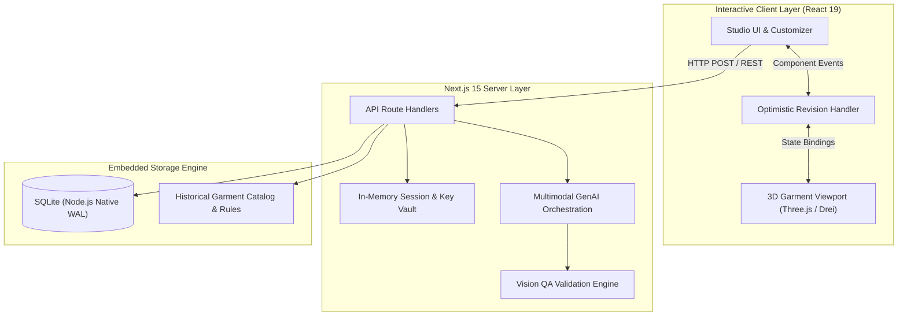

# Sac Viet Studio - Traditional Vietnamese Cultural Attire Showcase Platform

> Redesign traditional Vietnamese attire with precision and historical authenticity.
> Next.js 15 App Router | React 19 | Three.js | TypeScript | SQLite

[](https://nextjs.org/)
[](https://react.dev/)
[](https://threejs.org/)
[](https://www.typescriptlang.org/)
[](tests/)

---

## 1. Overview

Sac Viet Studio is a modern web application dedicated to the research, 3D visualization, and respectful contemporary reimagining of traditional Vietnamese historical garments. The system integrates parametric 3D garment rendering, historical fact retrieval, schema-driven design specifications, and multimodal generative AI.

The platform focuses on two principal garment lineages:
1. Five-Panel Robe (Ao Ngu Than Tay Chen - Nguyen Dynasty): Traditional standard featuring 5 fabric panels, standing collar (Lap Linh), right-side overlapping closure (Huu Nham) secured by 5 buttons representing the Five Constant Virtues (Nhan - Le - Nghia - Tri - Tin), and tapered sleeves.
2. Modern Ao Dai: The historical evolution traversing the Le Mur, Le Pho, and Raglan eras, characterized by fitted silhouettes, flowing panels, and contemporary cultural adaptations.

---

## 2. Key Technical Features

- Full-Stack Architecture: Next.js 15 App Router with React 19 Server and Client Components, strictly bound to localhost for security.
- Interactive 3D Visualization: Built using Three.js, React Three Fiber, and Drei. Supports 360-degree rotation, zoom, orthographic views (Front, Back, Left, Right), dynamic fabric material swapping, and WebGL fallbacks to parametric 2D technical schematics.
- In-Memory Secrets Isolation: API keys are maintained purely in ephemeral server session memory bound to HttpOnly cookies, completely isolated from client-side storage, SQLite databases, and version control.
- Multimodal AI Integration: Incorporates the Google GenAI SDK for generative concept synthesis, paired with an automated Vision QA pipeline that cross-references generated imagery against strict OutfitSpec data schemas.
- Native SQLite Persistence: Utilizes Node.js native SQLite in Write-Ahead Logging (WAL) mode for fast, zero-dependency persistence of lookbooks, revision logs, and design assets.
- Optimistic Concurrency Control: Robust revision tracking preventing data divergence, complete with structured undo/redo stacks.
- Technical Design Brief Export: Generates printable production specifications, JSON metadata schemas, colorway palettes, and tailor manufacturing guidance.

---

## 3. System Architecture



---

## 4. Getting Started

### Prerequisites
- Node.js: Version 20.x, 22.x, or 24.x
- npm: Version 10.x or higher

### Installation
```bash
# Clone the repository
git clone https://github.com/nhdnhut/sac-viet-heritage-studio.git
cd sac-viet-heritage-studio

# Install dependencies
npm install

# Start the development server
npm run dev
```

Open [http://localhost:3000](http://localhost:3000) in your web browser.

### Production Build
```bash
# Compile and build the production bundle
npm run build

# Start the production server
npm run start
```

---

## 5. Verification and Automated Testing

The repository includes a comprehensive Node.js native test harness covering schema validation, tool security, revision concurrency, and database integrity.

```bash
npm test
```

Test Results Summary:
- Test Suites: 6
- Total Tests: 23 passed (0 failed, 100% success rate)
- Verification Scope: Belief palette guardrails, optimistic concurrency locks, Zod schema validation, secret isolation, and SQLite persistence.

---

## 6. Directory Structure

```
sac-viet-heritage-studio/
├── data/                       # Embedded catalog data and SQLite database
├── docs/                       # Architectural blueprints and domain research
├── src/
│   ├── app/                    # Next.js 15 App Router pages and layouts
│   ├── components/             # React UI components and 3D viewports
│   ├── lib/                    # Core libraries, SQLite client, and AI handlers
│   └── types/                  # TypeScript interface definitions and Zod schemas
├── tests/                      # Automated test suite
├── next.config.ts              # Next.js framework configuration
├── tailwind.config.ts          # Tailwind CSS styling configuration
├── tsconfig.json               # TypeScript compiler configuration
├── package.json                # Project dependencies and script declarations
├── LICENSE                     # MIT License file
└── README.md                   # Project documentation
```

---

## 7. License and Citation

This project is open-source under the MIT License. See [LICENSE](LICENSE) for full details.

Authored and engineered by Nhut Nguyen (@nhdnhut).

